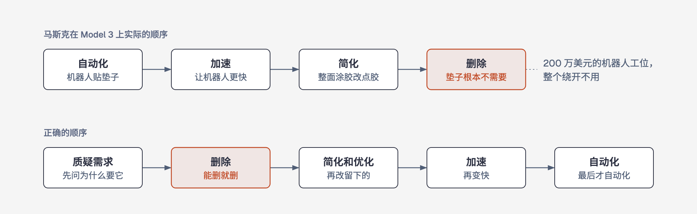
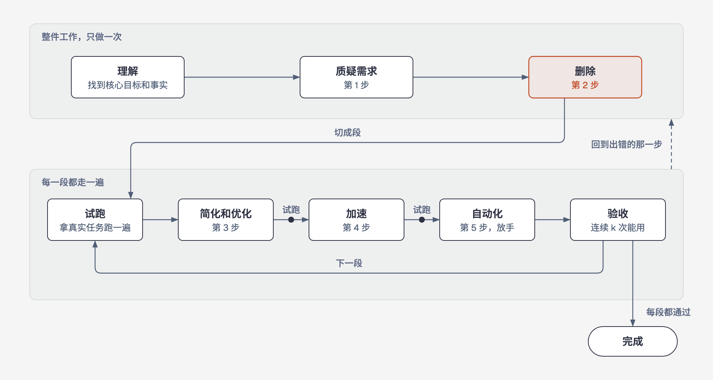

# 第一性原理工作流

一个 AI skill。它在对话里一步步带着你，把一件你反复在做的工作，变成一个能稳定运行的 AI 工作流。

## 它能帮你做到什么

每周写周报、回客户邮件、每月对账、定期发内容，这类反复做的事，都可以交给 AI。

"做完"的标准是：连续几次真实任务，AI 交出来的东西你都直接拿去用了。写出一段 prompt，或者成功跑通一次，都不算做完。

一路问下来，也可能发现这件事根本不该做，或者根本用不着 AI。这同样是一个结果，而且往往是最省事的那种。

## 为什么这样做

先说第一性原理。我们平时做事，多半是照着别人或者自己以前的做法，稍微改一改。第一性原理反过来：先把事情拆到最基本、能核实的事实，再从这些事实往上推出做法。放到你的工作上，就是先弄清楚你真正想要的结果是什么、手上有哪些事实，再决定怎么做，而不是照搬"别人都这么做"。

再说五步工作法。马斯克在 2021 年讲过五个步骤，顺序固定：质疑需求，删除，简化和优化，加速，自动化。2024 年他又把它叫作"一个非常基础的第一性原理算法"。

顺序为什么要紧，马斯克讲过他自己的一次教训。Model 3 的电池包上贴着一层玻璃纤维垫，他先上了机器人去贴，再让机器人贴得更快，又改进了涂胶方式，最后才问一句：这些垫子到底是干什么用的？结果在装和不装垫子的两辆车里各放一个麦克风，根本听不出区别。垫子删掉了，200 万美元的机器人工位也整个绕开不用了。用他的话说，聪明工程师最常犯的错，就是去优化一个本不该存在的东西。



AI 让"自动化"变得很便宜，这个错也就更容易犯：没想清楚的事，很快就被做得又快又多。所以这个 skill 先问、先删，最后才让 AI 放手去跑。

## 过程是什么样



理解、质疑需求、删除，针对整件工作做一次。然后把剩下的部分切成几段，每一段从试跑一路做到验收：拿真实任务跑一遍，改，再跑。出了问题，就回到出错的那一步，不用从头再来。一段通过验收，就可以先用起来，不必等全部做完。

你要做的事只有三种：

1. 回答 AI 的问题。大多数问题它都会附上推荐答案，你回一个"是"就行。
2. 拍板。删什么、留什么、标准怎么定，都由你决定。
3. 拿真实任务来试。

整个过程会跨好几天，因为要等真实任务来试跑，验收也要连续几次都通过。做得不频繁的工作，可以拿过去的真实任务回放，由你凭经验判断能不能用。

## 你始终说了算

- AI 只给推荐，最后都由你决定。
- 搭好的工作流不会悄悄改自己的规则。同一类修改反复出现，它才提出要改，你批准后才生效；每一处改动都能单独撤销。
- 对外发布、花钱、可能影响账号的操作，默认每次都要你确认，直到你明确放开。

## 安装和开始

Claude Code：

```bash
git clone https://github.com/Jackeyhan-JH/first-principles-workflow.git
mkdir -p ~/.claude/skills
cp -R first-principles-workflow/skills/first-principles-workflow ~/.claude/skills/
```

装好以后，对 AI 说一句你想交给它的事就可以开始，比如"每周五的周报我想交给 AI"。还没想好是哪件事，也可以直接说"我想用 AI 提高效率"。

每件工作的记录都放在 `~/ai-workflows/` 下，下次打开对话可以接着做。

## 许可证

MIT，见 [LICENSE](LICENSE)。`skills/first-principles-workflow/references/grilling.md` 复制自 Matt Pocock 的 [skills](https://github.com/mattpocock/skills) 仓库，同样是 MIT 许可证，版权声明附在那个文件末尾。
